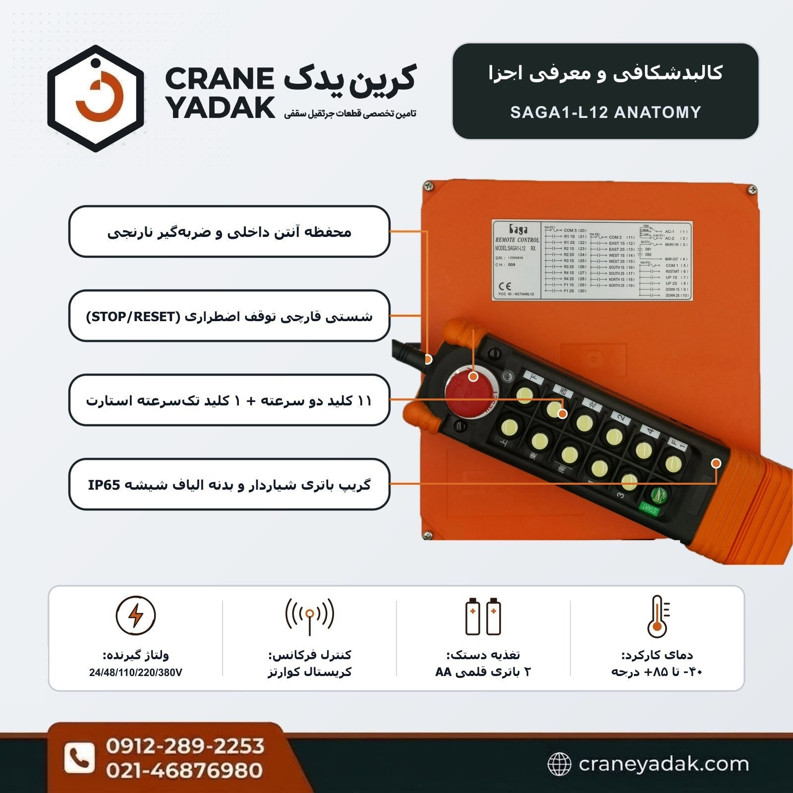

**جفت کردن ریموت ساگا** یعنی فرستنده و گیرنده یک کد شناسه‌ی مشترک بگیرند تا گیرنده فقط فرمان همان فرستنده را اجرا کند. هر وقت فرستنده یا گیرنده عوض شود — گم‌شدن، شکستن، تعمیر برد یا خرید فرستنده‌ی یدک — این کار لازم است. این راهنما روش رسمی سازنده برای [ریموت کنترل ساگا L12](/products/saga-saga1-l12/) و L10 را قدم‌به‌قدم توضیح می‌دهد: تنظیم کد از راه دور با خود فرستنده، و کپی کد با دستگاه کپیر.

:::callout warning پیش از هر کاری
جفت کردن روی جرثقیلی انجام می‌شود که برق دارد. بار را پایین بگذارید، کسی زیر جرثقیل نباشد، و پس از جفت کردن **همه‌ی حرکت‌ها را بی‌بار** و **شستی توقف اضطراری را** امتحان کنید.
:::

## جفت کردن ریموت ساگا چه زمانی لازم است؟ {nav="چه زمانی"}
کد شناسه‌ی ریموت‌های سری L ساگا ۳۲ بیتی است. گیرنده فقط به فرستنده‌ای پاسخ می‌دهد که همین کد را دارد؛ همین جلوی فرمان گرفتن از ریموت جرثقیل کناری را می‌گیرد. پس هر بار یکی از دو طرف عوض شود، کد باید دوباره یکی شود:

| موقعیت | روش پیشنهادی |
|---|---|
| فرستنده گم شده یا شکسته و فرستنده‌ی نو خریده‌اید | تنظیم کد از راه دور (روش ۱) |
| گیرنده سوخته و گیرنده‌ی نو نصب شده | تنظیم کد از راه دور با فرستنده‌ی سالم (روش ۱) |
| فرستنده‌ی دوم (یدک) برای همان گیرنده می‌خواهید | کپیر (روش ۲) |
| می‌خواهید تنظیمات کارکرد (مثلاً شتاب یا حرکت لحظه‌ای) هم منتقل شود | کپیر (روش ۲) |

## دو روش جفت کردن: تنظیم کد از راه دور یا کپیر {nav="دو روش"}

| | تنظیم کد از راه دور | کپیر ساگا |
|---|---|---|
| ابزار لازم | هیچ — فقط خود فرستنده | دستگاه کپیر سری L10/L12 |
| چه چیزی منتقل می‌شود | فقط کد شناسه | کد شناسه **و** تنظیمات کارکرد |
| باز کردن دستگاه | نه (مگر جامپر گیرنده نصب نباشد) | بله — فیش داخل فرستنده یا گیرنده |
| ریسک در کارگاه چندجرثقیلی | بالا — همه‌ی گیرنده‌های هم‌مدل در برد جفت می‌شوند | ندارد — فقط همان دستگاهی که به کپیر وصل است |
| مناسب برای | تعویض فرستنده یا گیرنده | فرستنده‌ی یدک، انتقال تنظیمات |

## پیش‌نیازهای جفت کردن ریموت ساگا {nav="پیش‌نیازها"}
اگر یکی از این شرط‌ها نباشد، جفت‌شدن انجام نمی‌شود و معمولاً هیچ پیغام خطایی هم نمی‌بینید:

1. **هم‌مدل:** فرستنده و گیرنده باید از یک مدل باشند (مثلاً هر دو SAGA1-L12).
2. **هم‌فرکانس:** کریستال فرستنده و گیرنده باید جفت باشد. نه تنظیم کد از راه دور و نه کپیر فرکانس را عوض نمی‌کند؛ فرکانس فقط با تعویض کریستال در هر دو دستگاه عوض می‌شود.
3. **جامپر گیرنده:** طبق دفترچه‌ی سازنده، برای فعال‌شدن تنظیم کد از راه دور یک جامپر داخل گیرنده لازم است.
4. **قابلیت فعال:** در نرم‌افزار تنظیم ساگا، بخش «R/C FUNCTION»، گزینه‌ی **«ID-Code Remote Setting»** باید روی **Enable** باشد. اگر **Disable** باشد، ترکیب EMS و UP و چهار بار DOWN هیچ اثری ندارد — حتی اگر همه‌ی شرط‌های دیگر درست باشد.
5. **باتری سالم:** فرستنده با دو باتری قلمی AA آلکالاین کار می‌کند؛ دفترچه باتری شارژی را منع می‌کند. چراغ قرمزی که هر ۲ ثانیه چشمک می‌زند یعنی باتری ضعیف است.

## روش ۱: جفت کردن ریموت ساگا L10 و L12 با تنظیم کد از راه دور {nav="روش ۱"}
این روش کد شناسه‌ی فرستنده را روی گیرنده می‌نویسد و ابزاری لازم ندارد:

1. فرستنده را تا جای ممکن **نزدیک گیرنده** ببرید.
2. برق گیرنده را کاملاً قطع کنید، **۲۰ ثانیه** صبر کنید و دوباره وصل کنید. از این لحظه **۴ دقیقه** فرصت دارید.
3. **شستی قارچی توقف اضطراری (EMS)** فرستنده را فشار دهید و نگه دارید.
4. کلید **UP** را فشار دهید و نگه دارید.
5. کلید **DOWN** را **۴ بار** بزنید.
6. وقتی چراغ **قرمز** فرستنده چشمک زد، EMS و UP را رها کنید.
7. سیستم را به روال عادی روشن کنید و همه‌ی حرکت‌ها را بی‌بار امتحان کنید.

:::callout warning اگر ID-Code Remote Setting روی Disable باشد
این روش اصلاً کار نمی‌کند. دو راه دارید: با نرم‌افزار تنظیم ساگا و کابل برنامه‌ریزی، «Read R/C» بزنید، در بخش «R/C FUNCTION» گزینه‌ی «ID-Code Remote Setting» را روی Enable بگذارید و «Write R/C» بزنید؛ یا بدون تغییر این تنظیم، کد را با کپیر منتقل کنید (روش ۲).
:::

:::callout tip اگر بار اول نشد
مراحل ۳ تا ۶ را تکرار کنید، ولی فقط تا ۴ دقیقه پس از روشن‌کردن گیرنده. بعد از آن گیرنده سیگنال تنظیم را نمی‌پذیرد و باید دوباره از مرحله‌ی ۲ شروع کنید.
:::

:::callout danger در کارگاهی که چند جرثقیل ساگا دارد
طبق دفترچه، **همه‌ی گیرنده‌های هم‌مدل و هم‌فرکانسِ روشن در برد** با همین فرستنده جفت می‌شوند. پیش از شروع، برق گیرنده‌ی جرثقیل‌های دیگر را قطع کنید؛ وگرنه فرستنده‌ی شما ممکن است جرثقیل دیگری را هم فرمان بدهد.
:::

## روش ۲: کپی کد و تنظیمات با کپیر ساگا {nav="روش ۲: کپیر"}
کپیر دستگاه کوچکی است که داده‌ی یک فرستنده یا گیرنده را می‌خواند، در حافظه‌اش نگه می‌دارد و روی دستگاه دیگر می‌نویسد — هم کد شناسه، هم تنظیمات کارکرد.

1. برق فرستنده یا گیرنده را **قطع** کنید.
2. فیش ۶ پین کپیر را در سوکت داخل دستگاه بگذارید.
3. **خواندن:** کلید مغناطیسی را روی گیرنده‌ی کپیر بگذارید، کلید **1** (یا 2 یا 3، یعنی خانه‌ی حافظه) را بزنید و رها کنید. چشمک چراغ **سبز** یعنی داده ذخیره شد.
4. فیش را جدا کنید و به دستگاه دوم وصل کنید (برق آن هم قطع).
5. **نوشتن:** کلید مغناطیسی را بردارید و همان کلید خانه‌ی حافظه را بزنید. چشمک سبز یعنی انتقال تمام شد.

| کپیر | با L10 و L12 | با L4، L6، L8، L6B، L8B |
|---|---|---|
| کپیر جدید (دو رنگ) | کار می‌کند | کار می‌کند |
| کپیر قدیمی (آبی) | **کار نمی‌کند** | کار می‌کند |

## جفت کردن فرستنده‌ی یدک با همان گیرنده {nav="فرستنده‌ی یدک"}
تنظیم کد از راه دور کد فرستنده‌ی **تازه** را روی گیرنده می‌نویسد؛ پس فرستنده‌ی قدیمی که کد دیگری دارد، دیگر فرمانش اجرا نمی‌شود. اگر می‌خواهید هر دو فرستنده کار کنند — مثلاً یکی یدک کنار تابلو — داده‌ی فرستنده‌ی اول را با کپیر بخوانید و روی فرستنده‌ی دوم بنویسید (روش ۲). هر دو یک کد می‌گیرند و گیرنده به هر دو پاسخ می‌دهد.

اگر فرستنده‌ی یدک می‌خواهید، هنگام استعلام کانال فرکانس (CH روی پلاک گیرنده) را هم بفرستید؛ کریستال فرستنده باید با همان کانال جفت باشد. فهرست مدل‌ها در [دسته‌ی ریموت کنترل جرثقیل سقفی](/categories/control-safety/remote-control/) و [برند ساگا](/brands/saga/) است.

## ریموت ساگا جفت نمی‌شود؟ عیب‌یابی {nav="عیب‌یابی"}

| نشانه | علت محتمل | راه حل |
|---|---|---|
| چراغ قرمز پس از ۴ بار DOWN چشمک نمی‌زند | شستی EMS یا UP رها شده، یا ترتیب کلیدها اشتباه است | EMS و UP را تا آخر نگه دارید؛ دوباره از مرحله‌ی ۲ |
| چراغ چشمک زد ولی گیرنده پاسخ نمی‌دهد | بیش از ۴ دقیقه از روشن‌شدن گیرنده گذشته | برق گیرنده ۲۰ ثانیه قطع و وصل، دوباره |
| هیچ‌وقت جفت نمی‌شود | «ID-Code Remote Setting» در نرم‌افزار ساگا روی Disable است | با نرم‌افزار Enable کنید، یا از کپیر استفاده کنید |
| هیچ‌وقت جفت نمی‌شود | جامپر گیرنده نصب نیست | جامپر داخل گیرنده را بررسی کنید |
| هیچ‌وقت جفت نمی‌شود | کریستال فرستنده و گیرنده جفت نیست یا مدل‌ها فرق دارند | کانال (CH) هر دو را مقایسه کنید |
| جرثقیل دیگری هم فرمان می‌گیرد | گیرنده‌ی هم‌مدل دیگری هنگام جفت کردن روشن بوده | همان گیرنده را با فرستنده‌ی خودش دوباره جفت کنید |

معنای بقیه‌ی حالت‌های چراغ دستک (قرمز سریع، کند، ثابت) در [راهنمای باتری و چراغ LED ریموت ساگا](/blog/saga-remote-battery-led/) آمده است.

اگر پس از این‌ها جفت نشد، عکس پلاک گیرنده (MODEL، CH و S/N) را برای ما بفرستید تا بررسی کنیم.

## پرسش‌های متداول درباره‌ی جفت کردن ریموت ساگا {nav="پرسش‌ها"}
:::faq
### آیا بدون کپیر می‌توان ریموت ساگا را جفت کرد؟
بله. در L10 و L12، تنظیم کد از راه دور فقط با خود فرستنده انجام می‌شود؛ به شرطی که جامپر گیرنده نصب باشد و «ID-Code Remote Setting» در نرم‌افزار ساگا روی Enable باشد. اگر Disable باشد، فقط کپیر یا نرم‌افزار کار می‌کند.
### جفت کردن تنظیمات کارکرد ریموت را عوض می‌کند؟
تنظیم کد از راه دور فقط کد شناسه را عوض می‌کند. کپیر هم کد شناسه و هم تنظیمات کارکرد را منتقل می‌کند.
### دو فرستنده‌ی ساگا را می‌توان با یک گیرنده جفت کرد؟
بله، با کپیر: داده‌ی فرستنده‌ی اول را روی فرستنده‌ی دوم بنویسید تا هر دو یک کد داشته باشند. تنظیم کد از راه دور کد گیرنده را با فرستنده‌ی تازه عوض می‌کند و فرستنده‌ی قبلی از کار می‌افتد.
### جفت کردن فرکانس ریموت را عوض می‌کند؟
نه. فرکانس با کریستال تعیین می‌شود و فقط با تعویض کریستال در هر دو فرستنده و گیرنده عوض می‌شود.
### کپیر قدیمی آبی با ریموت L12 کار می‌کند؟
نه. طبق دفترچه‌ی سازنده، کپیر قدیمی آبی با L10 و L12 کار نمی‌کند؛ کپیر جدید دو رنگ با هر دو نسل کار می‌کند.
### روش جفت کردن L4 تا L8B هم همین است؟
دفترچه‌ی این راهنما برای L10 و L12 است. برای مدل‌های قدیمی‌تر، دفترچه‌ی همان مدل را ببینید یا با ما [تماس بگیرید](/contact/).
:::
