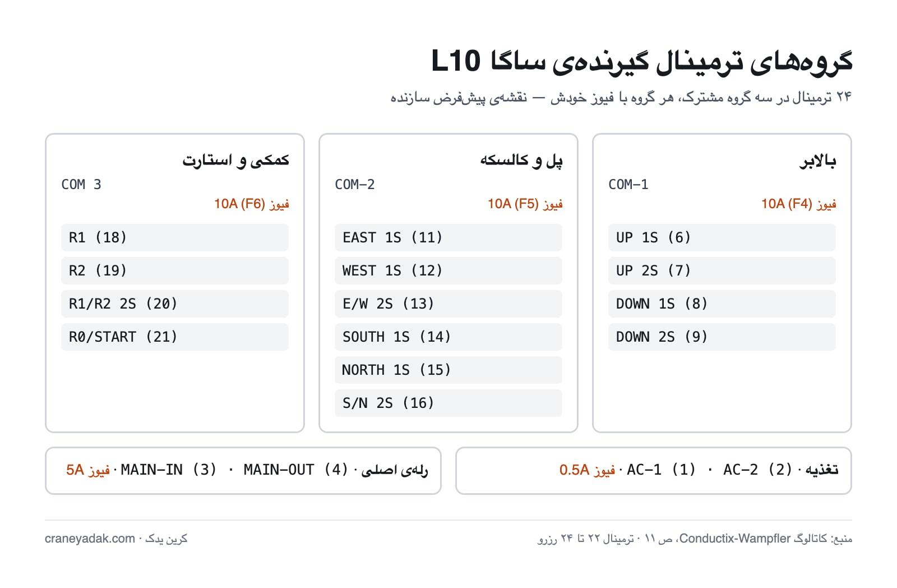

**گیرنده ریموت ساگا L10** جعبه‌ی رله‌ای است که روی تابلو برق جرثقیل می‌نشیند و فرمان دستک هشت‌کلیدی را به کنتاکتورها می‌رساند. این صفحه فقط خود گیرنده است: دستک سالم شما سر جایش می‌ماند و فقط جعبه‌ی روی تابلو عوض می‌شود. اگر دستک هم لازم دارید، [ست کامل ریموت کنترل ساگا L10](/products/saga-saga1-l10/) را ببینید. در بازار «رسیور ساگا ال ۱۰» هم گفته می‌شود.

## نقشه‌ی سیم‌بندی گیرنده ریموت ساگا L10 {nav="ترمینال‌ها"}
نقشه‌ی پیش‌فرض کاتالوگ سازنده، ۲۴ ترمینال در سه گروه مشترک (COM) با فیوز جدا:

| ترمینال | نام | کار |
|---|---|---|
| 1 و 2 | AC-1، AC-2 | تغذیه (فیوز 0.5A) |
| 3 و 4 | MAIN-IN، MAIN-OUT | رله‌ی اصلی (فیوز 5A) |
| 5 | COM-1 | مشترک بالابر (فیوز 10A) |
| 6 تا 9 | UP 1S/2S، DOWN 1S/2S | بالا و پایین، هر جهت دو سرعت |
| 10 | COM-2 | مشترک پل و کالسکه (فیوز 10A) |
| 11 تا 16 | EAST 1S، WEST 1S، E/W 2S، SOUTH 1S، NORTH 1S، S/N 2S | پل و کالسکه؛ سرعت دوم هر محور مشترک |
| 17 | COM 3 | مشترک کمکی (فیوز 10A) |
| 18 تا 21 | R1، R2، R1/R2 2S، R0/START | حرکت کمکی و استارت |
| 22 تا 24 | SPARE | رزرو |

سازنده یادآوری می‌کند که برنامه‌ریزی سفارشی می‌تواند خروجی رله‌ها را عوض کند؛ پس مرجع سیم‌کشی، پلاک همان گیرنده‌ای است که از تابلو جدا می‌کنید؛ قبل از جدا کردن سیم‌ها از آن عکس بگیرید.

## ولتاژ تغذیه {nav="ولتاژ"}
گیرنده‌ی L10 با ولتاژ **۲۴، ۴۸، ۱۱۰، ۲۲۰ یا ۳۸۰ ولت، AC یا DC** عرضه می‌شود و با ولتاژ فرمان تابلوی شما سفارش داده می‌شود.

## نصب و راه‌اندازی {nav="نصب"}
گیرنده روی تابلو برق نصب می‌شود، نه داخل آن، و دور از اینورتر و کابل قدرت. مراحل کامل در [راهنمای نصب گیرنده ریموت جرثقیل](/blog/saga-receiver-installation/) است. گیرنده‌ی نو باید یک بار با دستک جفت شود؛ برای روش کد از راه دور، جامپر داخل گیرنده لازم است — [راهنمای جفت کردن](/blog/saga-remote-pairing/).

## پرسش‌های متداول گیرنده ساگا L10 {nav="پرسش‌ها"}
:::faq
### گیرنده‌ی L10 را بدون دستک می‌شود خرید؟
بله، اگر دستک فعلی SAGA1-L10 است. کانال پلاک گیرنده‌ی قدیمی را هنگام سفارش بفرستید.
### چرا سرعت دوم شرق و غرب یک ترمینال دارد؟
در نقشه‌ی پیش‌فرض L10، سرعت دوم هر محور (E/W و S/N) یک رله‌ی مشترک دارد. اگر تابلوی شما برای هر جهت سرعت دوم جدا می‌خواهد، پیش از سفارش بپرسید.
### گیرنده‌ی L10 با دستک L12 کار می‌کند؟
نه. مدل دستک و گیرنده باید یکی باشد.
:::
