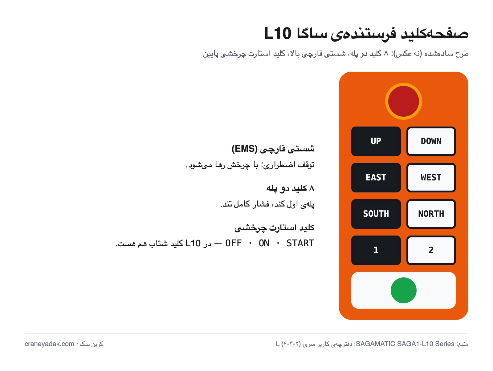

**فرستنده ریموت ساگا L10** دستک کوچک هشت‌کلیدی است که اپراتور در دست دارد، بی گیرنده. وقتی دستک قبلی افتاده و شکسته، گم شده، یا برای شیفت دوم دستک جدا می‌خواهید، گیرنده‌ی روی جرثقیل سر جایش می‌ماند و فقط همین عوض می‌شود. اگر گیرنده هم ندارید، [ست کامل ریموت کنترل ساگا L10](/products/saga-saga1-l10/) مناسب‌تر است. در بازار «دستک ساگا ال ۱۰» هم گفته می‌شود.

## این دستک با کدام گیرنده کار می‌کند؟ {nav="سازگاری"}
دستک L10 فقط با گیرنده‌ی SAGA1-L10 و فقط روی همان کانال فرمان می‌دهد. پیش از سفارش از پلاک گیرنده بخوانید:

| روی پلاک گیرنده | چرا مهم است |
|---|---|
| مدل | دستک L12 یا L10-1 جای L10 کار نمی‌کند |
| CH (کانال) | کریستال دستک برای همین کانال سفارش داده می‌شود |
| S/N (شماره‌ی سریال) | کاتالوگ سازنده آن را برای جفت کردن دستک یدک لازم می‌داند |

## کلید استارت چرخشی و شتاب {nav="کلیدها"}

در L10 روشن و خاموش و استارت با یک کلید چرخشی پایین دستک انجام می‌شود، نه با کلید سوئیچی و شستی جدا. دفترچه‌ی سری L می‌گوید در L10 همین کلید استارت، کلید شتاب هم هست: وقتی حرکتی در پله‌ی دوم است، چرخاندن کوتاه کلید سرعت را بالاتر می‌برد؛ به شرطی که آن قابلیت در تنظیمات فعال شده باشد و کلید حرکت در پله‌ی دوم نگه داشته شود.

## باتری فرستنده ریموت ساگا L10 {nav="باتری"}
دو باتری قلمی AA. صفحه‌ی رسمی SAGA برای L10 باتری یک‌بارمصرف یا شارژی Ni-MH را نام می‌برد و عمر را تا حدود سه ماه اعلام می‌کند. چراغ LED سه‌مرحله‌ای دستک سطح باتری، ارسال رادیویی و پیام خطا را نشان می‌دهد؛ معنای چشمک‌ها در [راهنمای باتری و چراغ LED](/blog/saga-remote-battery-led/) آمده است.

## راه‌اندازی دستک تازه {nav="راه‌اندازی"}
دستک نو تا با گیرنده جفت نشود فرمان نمی‌دهد. روش کد از راه دور و روش کپیر در [راهنمای جفت کردن ریموت ساگا](/blog/saga-remote-pairing/) است؛ برای L10 و L12 یکی است.

## پرسش‌های متداول فرستنده ساگا L10 {nav="پرسش‌ها"}
:::faq
### فرستنده‌ی L10 را جدا می‌شود خرید؟
بله، اگر گیرنده‌ی جرثقیل SAGA1-L10 است. کانال و شماره‌ی سریال پلاک گیرنده را هنگام سفارش بفرستید.
### دستک L10 به گیرنده‌ی L12 وصل می‌شود؟
نه. فرستنده و گیرنده باید هم‌مدل باشند.
### دو دستک برای یک جرثقیل ممکن است؟
بله، با کپیر هر دو دستک یک کد می‌گیرند و گیرنده به هر دو پاسخ می‌دهد.
:::
