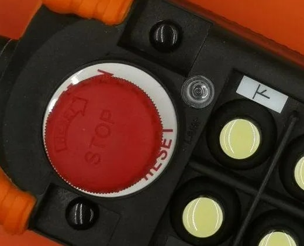

**فرستنده ریموت ساگا L12** همان دستکی است که اپراتور در دست می‌گیرد، این بار بدون گیرنده. وقتی دستک قبلی گم شده، از ارتفاع افتاده و بدنه‌اش ترک خورده، یا کارگاه یک دستک دوم کنار تابلو می‌خواهد، لازم نیست ست کامل را دوباره بخرید: گیرنده‌ی نصب‌شده روی جرثقیل سالم می‌ماند و فقط دستک عوض می‌شود. اگر هنوز گیرنده‌ای ندارید، [ست کامل ریموت کنترل ساگا L12](/products/saga-saga1-l12/) را ببینید. در بازار «دستک ساگا ال ۱۲» هم گفته می‌شود.

## این فرستنده با کدام گیرنده کار می‌کند؟ {nav="سازگاری"}
دستک فقط با گیرنده‌ای فرمان می‌دهد که سه چیزش با آن یکی باشد. پیش از سفارش هر سه را از روی پلاک گیرنده‌ی فعلی بخوانید:

| روی پلاک گیرنده | باید چه باشد | اگر فرق داشت |
|---|---|---|
| MODEL | SAGA1-L12 RX | این فرستنده مناسب نیست؛ مدل گیرنده را بفرستید |
| CH (کانال) | همان کانالی که کریستال فرستنده با آن سفارش داده می‌شود | کریستال جفت نیست و فرمانی نمی‌رسد |
| S/N | فقط برای پیگیری | — |

فرستنده‌ی L10 یا L12-1 با گیرنده‌ی L12 کار نمی‌کند، حتی اگر ظاهرشان شبیه باشد: تعداد و نوع کلیدها و نقشه‌ی خروجی فرق دارد.

## دستک تازه را چطور به گیرنده‌ی فعلی وصل کنیم؟ {nav="راه‌اندازی"}
دستک نو کد شناسه‌ی خودش را دارد و گیرنده تا آن کد را یاد نگیرد، فرمانش را اجرا نمی‌کند. دو راه هست: تنظیم کد از راه دور با خود دستک، یا کپی کد با دستگاه کپیر. مراحل هر دو، پیش‌نیازها و هشدار کارگاه‌های چندجرثقیلی در [راهنمای جفت کردن ریموت ساگا](/blog/saga-remote-pairing/) آمده است.

:::callout warning اگر دستک قبلی پیدا شد
پس از جفت کردن دستک نو با روش کد از راه دور، دستک قبلی دیگر فرمان نمی‌دهد. اگر می‌خواهید هر دو کار کنند، کد را با کپیر از یکی روی دیگری بنویسید.
:::

## کلیدها و نشانگر روی دستک {nav="کلیدها"}
- **شستی قارچی قرمز:** توقف اضطراری؛ تا چرخانده و رها نشود، دستک هیچ فرمانی نمی‌فرستد.
- **۱۲ کلید حرکت:** یازده کلید دو پله (پله‌ی اول کند، فشار کامل تند) و یک کلید تک‌سرعته.
- **کلید سبز START:** رله‌ی اصلی گیرنده را وصل می‌کند.
- **کلید سوئیچی:** روشن و خاموش؛ با برداشتنش دستک از دسترس افراد متفرقه خارج می‌شود.
- **چراغ LED:** کنار شستی قارچی؛ سبز چشمک‌زن یعنی باتری پر.

برچسب‌های چاپی روی کلیدهای دستک با نام خروجی‌های پلاک گیرنده یکی است؛ حرکت‌های اصلی با حروف چینی نوشته شده‌اند:

| برچسب روی کلید | معنی | خروجی روی پلاک گیرنده |
|---|---|---|
| 上 / 下 | بالا / پایین | UP / DOWN |
| 東 / 西 | شرق / غرب | EAST / WEST |
| 南 / 北 | جنوب / شمال | SOUTH / NORTH |
| 1 تا 4 و F1 | حرکت‌های کمکی | R1 تا R4 و F1 |
| START | استارت | R0/START |

## باتری فرستنده ریموت ساگا L12 {nav="باتری"}
دستک با دو باتری قلمی AA آلکالاین کار می‌کند. سازنده باتری شارژی را منع کرده است. وقتی چراغ هر دو ثانیه یک بار قرمز می‌زند، برد کم شده و باید همان روز باتری عوض شود؛ معنای همه‌ی حالت‌های چراغ در [راهنمای باتری و چراغ LED ریموت ساگا](/blog/saga-remote-battery-led/) است.

## پیش از سفارش فرستنده بفرستید {nav="سفارش"}
1. عکس واضح پلاک گیرنده (MODEL، CH، S/N).
2. اگر دستک قبلی را دارید، عکس روی آن — برای تطبیق برچسب کلیدها با حرکت‌های جرثقیل.
3. آیا دستک قبلی باید کار کند (فرستنده‌ی دوم) یا جایگزین است؟

## پرسش‌های متداول فرستنده‌ی ساگا L12 {nav="پرسش‌ها"}
:::faq
### فرستنده ساگا L12 را بدون گیرنده می‌شود خرید؟
بله. این صفحه فقط دستک است و گیرنده‌ی فعلی جرثقیل سر جایش می‌ماند. شرطش این است که گیرنده هم SAGA1-L12 باشد و کانالش را بدانیم.
### دستک نو بلافاصله کار می‌کند؟
نه. باید یک بار با گیرنده جفت شود تا کد شناسه‌اش را بشناسد. روش کد از راه دور ابزاری نمی‌خواهد و در پنجره‌ی ۴ دقیقه‌ای پس از روشن‌شدن گیرنده انجام می‌شود؛ اگر این قابلیت در گیرنده خاموش باشد، کپیر لازم است.
### دو دستک برای یک جرثقیل ممکن است؟
بله، با کپیر: هر دو دستک یک کد می‌گیرند و گیرنده به هر دو پاسخ می‌دهد.
### دستک L10 را می‌شود به گیرنده‌ی L12 وصل کرد؟
نه. مدل فرستنده و گیرنده باید یکی باشد.
:::
