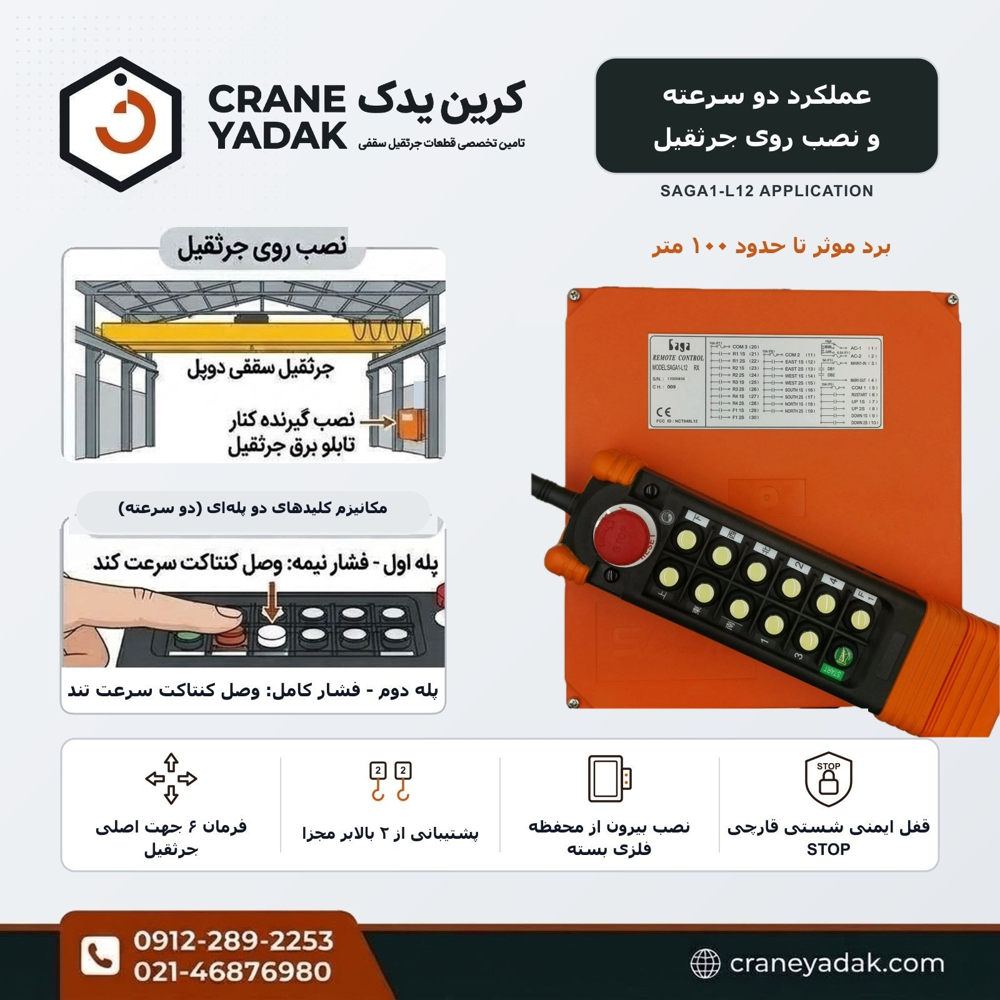
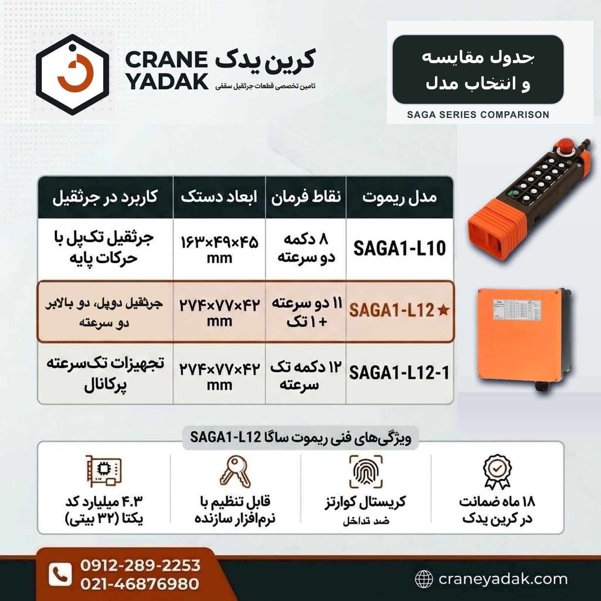
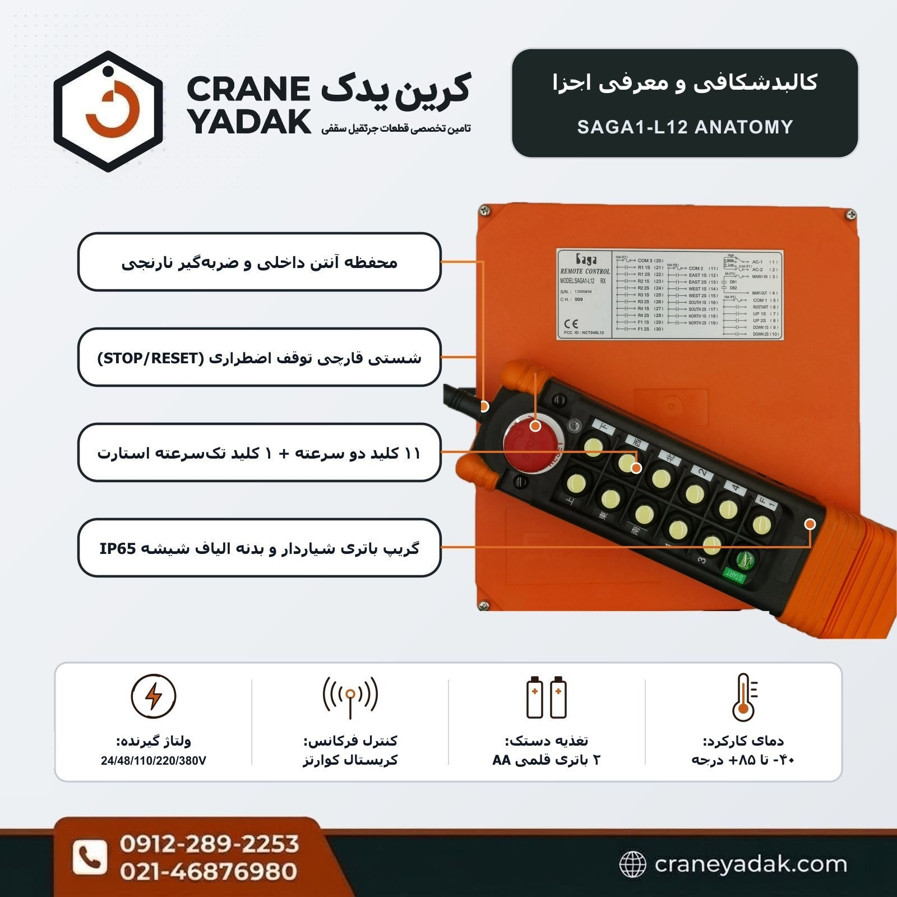

**ریموت کنترل ساگا L12** (کد سازنده SAGA1-L12) ریموت کنترل رادیویی جرثقیل سقفی، ساخت تایوان، با **۱۱ کلید دو سرعته**، یک کلید تک‌سرعته، کلید استارت، کلید سوئیچی و شستی قارچی توقف اضطراری است. فرستنده و گیرنده با هم یک ست‌اند و برای جرثقیل‌هایی ساخته شده‌اند که بیشتر از یک بالابر ساده حرکت دارند: جرثقیل دوپل، جرثقیل با دو بالابر یا دو کالسکه، و هر دستگاهی که حرکت‌هایش دو سرعته است. در بازار «ریموت ۱۲ کاناله ساگا» هم نامیده می‌شود.

:::callout info در یک نگاه
۱۱ کلید دو سرعته + ۱ تک‌سرعته · برد تا ۱۰۰ متر · IP65 · دمای کار منفی ۴۰ تا مثبت ۸۵ درجه · فرستنده با ۲ باتری قلمی AA تا حدود ۳ ماه · گیرنده‌ی ۲۴، ۴۸، ۱۱۰، ۲۲۰ یا ۳۸۰ ولت AC/DC. جدول کامل مشخصات بالای همین صفحه است.
:::

## معرفی ویدیویی ریموت کنترل ساگا L12 {nav="ویدیو"}
:::video url="https://www.aparat.com/v/inl6nb2" alt="معرفی ویدیویی ریموت کنترل ساگا SAGA1-L12"

## ریموت ساگا L12 برای کدام جرثقیل مناسب است؟ {nav="کاربرد"}
هر **کلید دو سرعته** دو پله دارد: فشار نیمه سرعت اول (کند) را فعال می‌کند و فشار کامل سرعت دوم (تند) را. اپراتور بار سنگین را آرام از زمین جدا می‌کند و در مسیر آزاد سریع جابه‌جا می‌کند، بی کلید جداگانه برای هر سرعت.

پلاک گیرنده‌ی SAGA1-L12 خروجی‌ها را این‌طور نام‌گذاری کرده است — همین فهرست نشان می‌دهد L12 برای چه دستگاهی ساخته شده:

| خروجی گیرنده | کاربرد معمول | سرعت |
|---|---|---|
| UP / DOWN | بالابر اصلی | دو سرعته |
| EAST / WEST | حرکت پل | دو سرعته |
| SOUTH / NORTH | حرکت کالسکه | دو سرعته |
| R1 تا R4 | چهار حرکت کمکی، مثلاً بالابر دوم | دو سرعته |
| F1 | یک فرمان اضافه | دو سرعته |
| START | وصل رله‌ی اصلی | — |

## L12، L10 یا L12-1: کدام ریموت ساگا را بخرم؟ {nav="مقایسه مدل‌ها"}
این سه مدل هم‌خانواده در بازار ایران بیشتر از بقیه با هم اشتباه گرفته می‌شوند. داده‌ها از صفحه‌های رسمی سازنده است:

| مشخصه | SAGA1-L10 | SAGA1-L12 | SAGA1-L12-1 |
|---|---|---|---|
| کلیدهای حرکت | ۸ دو سرعته | ۱۱ دو سرعته + ۱ تک‌سرعته | ۱۲ تک‌سرعته |
| فرستنده | ۱۶۳ × ۴۹ × ۴۵ میلی‌متر، حدود ۲۱۰ گرم | ۲۷۴ × ۷۷ × ۴۲ میلی‌متر، حدود ۴۰۰ گرم | ۲۷۴ × ۷۷ × ۴۲ میلی‌متر، حدود ۴۰۰ گرم |
| گیرنده | ۱۶۷ × ۱۵۴ × ۸۸ میلی‌متر، حدود ۱۴۰۰ گرم | ۲۵۳ × ۲۶۷ × ۱۵۰ میلی‌متر، حدود ۳۰۰۰ گرم | ۲۵۳ × ۲۶۷ × ۱۵۰ میلی‌متر، حدود ۳۰۰۰ گرم |
| مناسب برای | جرثقیل تک‌پل با حرکات پایه | دوپل، دو بالابر، حرکات دو سرعته | دستگاه تک‌سرعته با حرکات زیاد |

:::callout tip قاعده‌ی انتخاب
تعداد حرکت‌ها را از روی تابلوی فرمان فعلی بشمارید، نه از حدس؛ هر حرکت دوطرفه دو کلید مصرف می‌کند. دو سرعته و بیش از ۸ کلید ← **L12**. همه تک‌سرعته ← **L12-1**. تک‌پل با یک بالابر ← **L10** سبک‌تر و کافی است.
:::

## اجزای فرستنده و گیرنده‌ی SAGA1-L12 {nav="اجزا"}
- **شستی قارچی توقف اضطراری (EMS):** همه‌ی فرمان‌ها را قطع می‌کند؛ تا رها نشود فرستنده فرمانی نمی‌فرستد.
- **۱۲ کلید حرکت:** ۱۱ دو سرعته و ۱ تک‌سرعته، هر کدام با برچسب حرکت.
- **کلید سوئیچی و کلید استارت:** کلید سوئیچی فرستنده را روشن می‌کند و استارت رله‌ی اصلی گیرنده را وصل؛ با برداشتن کلید، دستگاه از دسترس افراد غیرمجاز خارج می‌شود.
- **نشانگر LED سه مرحله‌ای:** سطح باتری، ارسال رادیویی و پیام خطا.
- **آنتن:** استوانه‌ی کوتاه مشکی روی سر فرستنده.
- **گیرنده:** درِ نارنجی روی بدنه‌ی مشکی، از پیش سیم‌کشی‌شده، با رله‌های خروجی 10A / 250VAC.

## پیش از سفارش این چهار مورد را بفرستید {nav="سفارش درست"}
ریموت اشتباه یعنی یک روز توقف دیگر. این چهار داده مدل، ولتاژ و فرکانس درست را قطعی می‌کند:

1. **عکس پلاک گیرنده‌ی فعلی** — MODEL، CH (کانال فرکانس) و S/N روی آن است.
2. **ولتاژ فرمان تابلو** — گیرنده باید با همان ولتاژ سفارش داده شود.
3. **تعداد حرکت‌ها و دو سرعته یا تک‌سرعته بودن هر کدام** — یا عکس تابلوی فرمان.
4. **تعداد جرثقیل‌های رادیویی دیگر در همان سالن** — تا فرکانس تکراری انتخاب نشود.

پیش از صدور پیش‌فاکتور همین‌ها را با مدل درخواستی تطبیق می‌دهیم؛ فاکتور رسمی صادر می‌شود و ضمانت اصالت همراه کالاست.

## تشخیص ریموت ساگا L12 اصل از روی پلاک {nav="اصالت"}
پلاک گیرنده‌ی اصلی SAGA1-L12 ارزان‌ترین راه بررسی اصالت است و این موارد را دارد:

- نشان **Saga** و عبارت **MODEL: SAGA1-L12 RX**
- شماره‌ی سریال (S/N) و کانال (CH)
- نشان CE و شناسه‌ی **FCC ID: NCT048L12**
- نقشه‌ی کامل ترمینال‌ها: UP/DOWN، EAST/WEST، SOUTH/NORTH، R1 تا R4 و F1، هر کدام با دو سرعت 1S و 2S

پیش از خرید می‌توانید عکس پلاک همان کالایی را که تحویل می‌گیرید بخواهید.

## قطعات یدکی رایج ریموت ساگا L12 {nav="قطعات یدکی"}
بسیاری از خرابی‌ها با یک قطعه رفع می‌شود و خرید ست کامل لازم نیست. قطعاتی که برای L12 جداگانه عرضه می‌شوند:

| قطعه | چه زمانی لازم می‌شود |
|---|---|
| [فرستنده‌ی تنها](/products/saga-saga1-l12-transmitter/) | گم‌شدن یا شکستن فرستنده، یا فرستنده‌ی دوم برای همان گیرنده |
| [گیرنده‌ی تنها](/products/saga-saga1-l12-receiver/) | از کار افتادن گیرنده در حالی که دستک سالم است |
| قاب فرستنده | ترک بدنه — IP65 فقط با بدنه‌ی سالم برقرار است |
| شستی قارچی توقف اضطراری | قطع نکردن فرمان در آزمون ابتدای شیفت |
| کلید دو پله | چسبندگی کلید یا کار نکردن سرعت دوم |
| کریستال فرکانس | تداخل با ریموت دیگر در همان سالن |
| آنتن و ترانس گیرنده | کاهش برد یا پاسخ ندادن گیرنده |

## پرسش‌های متداول خرید ریموت کنترل ساگا L12 {nav="پرسش‌ها"}
:::faq
### ریموت ساگا L12 چند کاناله است؟
فرستنده ۱۲ کلید حرکت دارد — ۱۱ کلید دو سرعته و ۱ کلید تک‌سرعته — به‌علاوه‌ی کلید استارت، کلید سوئیچی و شستی توقف اضطراری. به همین دلیل در بازار «ریموت ۱۲ کاناله ساگا» هم نامیده می‌شود.
### برد ریموت ساگا L12 چقدر است؟
سازنده برد را تا حدود ۱۰۰ متر اعلام کرده است. در سالن‌های فولادی و کنار اینورتر برد عملی کمتر است؛ محل نصب گیرنده بیشترین اثر را دارد.
### آیا می‌توان فقط فرستنده‌ی L12 را خرید؟
بله، [فرستنده‌ی ریموت ساگا L12](/products/saga-saga1-l12-transmitter/) و [گیرنده‌ی آن](/products/saga-saga1-l12-receiver/) جداگانه هم عرضه می‌شوند. پیش از خرید، کانال فرکانس (CH روی پلاک گیرنده) را بفرستید.
### ریموت ساگا L12 با چه باتری‌ای کار می‌کند؟
دو باتری قلمی AA آلکالاین ۱٫۵ ولت که طبق سازنده تا حدود سه ماه دوام دارد. دفترچه‌ی سازنده باتری شارژی را توصیه نمی‌کند و باتری شارژی شامل ضمانت کرین یدک نیست.
### گیرنده‌ی ساگا L12 با چه ولتاژی کار می‌کند؟
۲۴، ۴۸، ۱۱۰، ۲۲۰ یا ۳۸۰ ولت، AC یا DC. گیرنده باید با ولتاژ فرمان تابلوی شما سفارش داده شود.
### L12 را بگیرم یا L12-1؟
اگر حرکت‌های جرثقیل دو سرعته‌اند، L12؛ اگر همه تک‌سرعته‌اند، L12-1. اگر مطمئن نیستید، عکس تابلوی فرمان را بفرستید.
:::
